# EnergyPlus cards

Seven Home Assistant dashboard cards that show your energy use in more detail than the
built-in Energy dashboard — in one download:

| Card | Type |
|---|---|
| [Key figures](#key-figures) | `custom:energyplus-kpi-card` |
| [Live energy flow](#live-energy-flow) | `custom:energyplus-live-flow-card` |
| [Devices](#devices) | `custom:energyplus-devices-card` |
| [Solar](#solar) | `custom:energyplus-solar-card` |
| [Costs](#costs) | `custom:energyplus-costs-card` |
| [Off-peak and peak](#off-peak-and-peak) | `custom:energyplus-tariff-card` |
| [Appliance cycles](#appliance-cycles) | `custom:energyplus-cycles-card` |

*Screenshots show sample data.*

The cards are part of the [EnergyPlus](https://github.com/martijntalens/EnergyPlus)
project, but work on their own: the EnergyPlus app does not need to be installed or
running. They use the configuration of the Home Assistant **Energy dashboard**
(*Settings → Dashboards → Energy*), so set that up first.

## Installation

### Marketplace (formerly HACS) — recommended

1. In Home Assistant open **Marketplace** and choose **Add from a GitHub link**.
2. Enter `https://github.com/martijntalens/energyplus-cards` and click **Add**.
3. Find **EnergyPlus cards**, download it and reload the browser when asked.

On an older HACS version: open **⋮ → Custom repositories**, add the same link with type
**Dashboard**, then download.

### Manual

1. Download [`dist/energyplus-cards.js`](dist/energyplus-cards.js) and copy it to the `www` folder in
   your Home Assistant configuration folder.
2. Go to **Settings → Dashboards → ⋮ → Resources → Add resource**, enter
   `/local/energyplus-cards.js` and choose **JavaScript module**.
3. Reload the browser.

## Usage

Edit a dashboard, **Add card** and search for **EnergyPlus**. Every card has a visual
editor; the YAML options are listed per card below.

### Period

The period cards have their own buttons (day, week, month, year) and ‹ › to step back
in time. With `energy_date_selection: true` a card follows the date picker of the
Energy dashboard instead (add the *Energy date picker* card to the same dashboard).
This uses the energy data of the Home Assistant frontend, which is not an official
interface for custom cards; if it is not available, the card uses its own buttons.

Several EnergyPlus cards on one dashboard share the data they load.

## Key figures

`type: custom:energyplus-kpi-card`

Key figures of your energy use in one card: home consumption, grid import and return, solar production, self-sufficiency, net electricity cost, gas and water — each with the change versus the previous period (compared at the same point in time while a period is still running).

| Light theme | Dark theme |
|---|---|
| 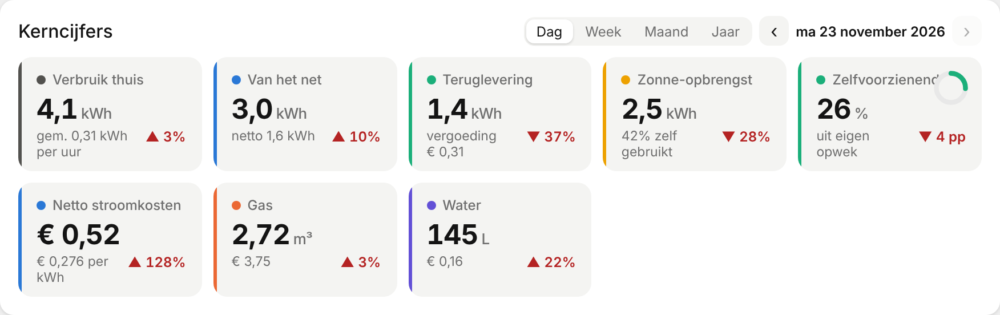 | 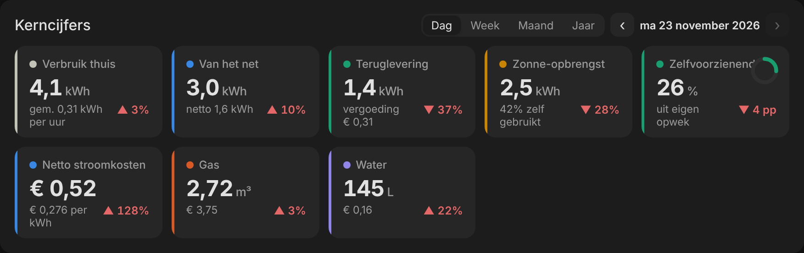 |

All options are optional:

```yaml
type: custom:energyplus-kpi-card
title: Mijn titel                 # empty string hides the header
period: day                      # day | week | month | year (start view)
show_navigation: true            # period buttons and ‹ › in the card
energy_date_selection: false     # follow the date picker of the Energy dashboard
compare: true                    # show the change versus the previous period
tiles:                           # which tiles, in this order (default: all available)
  - home
  - grid_in
  - export
  - solar
  - self_sufficiency
  - net_cost
  - gas
  - water
```

Tiles for which there is no data (e.g. battery without a battery) are hidden automatically.

## Live energy flow

`type: custom:energyplus-live-flow-card`

Animated live power flow from the grid and your solar panels to your home, and from your home to every device with a power sensor. The remainder is shown as *Not measured separately*.

| Light theme | Dark theme |
|---|---|
| 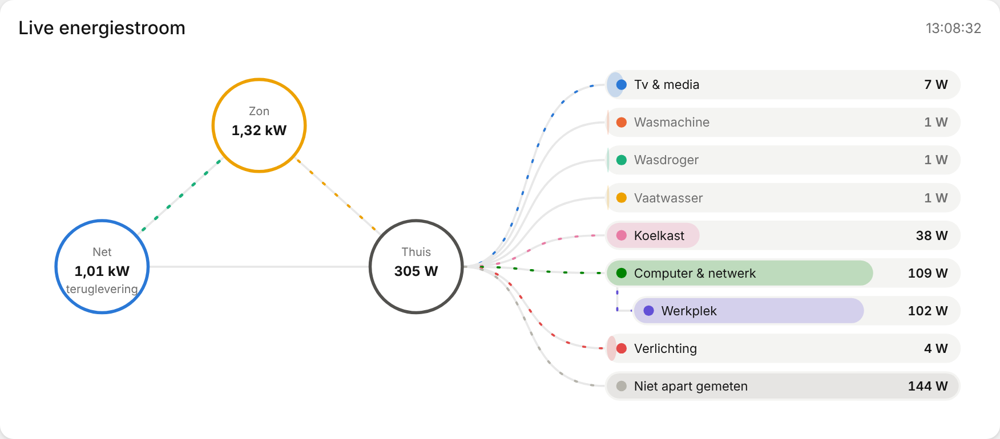 | 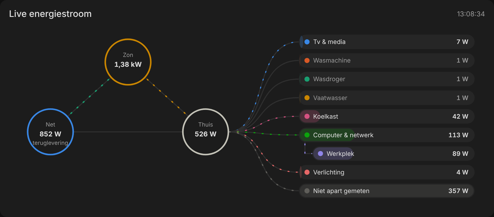 |

All options are optional:

```yaml
type: custom:energyplus-live-flow-card
title: Live energiestroom
grid_power: sensor.p1_power              # W or kW; positive = import, negative = return
grid_power_export: sensor.p1_power_production   # optional separate return sensor
solar_power: sensor.inverter_power
battery_power: sensor.battery_power      # optional; positive = discharging
battery_soc: sensor.battery_level        # optional
show_devices: true
stale_minutes: 5                         # mark sensors without a new reading after this time
device_power:                            # only when a power sensor is not found automatically
  sensor.washer_energy: sensor.washer_power
```

- Power sensors set in the Energy dashboard settings are used automatically.
- For each device in the Energy dashboard the card looks for a power sensor on the same Home Assistant device (smart plugs usually have both an energy and a power sensor), then for a sensor named like `…_power`.
- **Sensor checks.** A sensor that shows power but has not reported for longer than `stale_minutes` is marked with ⏱ and its age. When the devices together use more than the home in total (solar + grid), *Not measured separately* shows "devices > home ?": the sensors disagree (a slow cloud integration, a grid sensor that measures one phase, or devices counted twice).
- On narrow screens the devices are shown as a list below the diagram.

## Devices

`type: custom:energyplus-devices-card`

Consumption and cost per device from the Energy dashboard, as a ranking with share of the total or as a stacked timeline. Nested devices (*included in*) are indented, and *Not measured separately* is shown explicitly.

| Light theme | Dark theme |
|---|---|
| 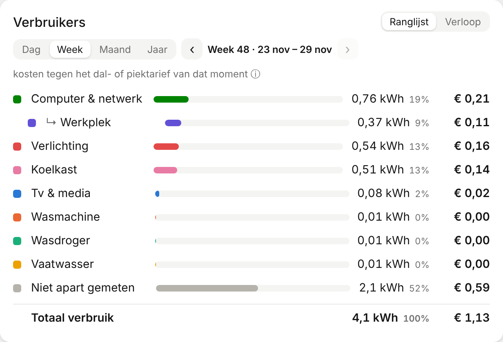 | 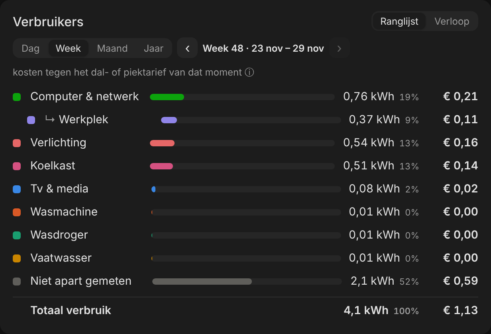 |

All options are optional:

```yaml
type: custom:energyplus-devices-card
title: Mijn titel                 # empty string hides the header
period: day                      # day | week | month | year (start view)
show_navigation: true            # period buttons and ‹ › in the card
energy_date_selection: false     # follow the date picker of the Energy dashboard
view: list                       # list | chart (can also be switched in the card)
show_cost: true
```

**Cost per device** = consumption × the price of the rate that applied in that hour (tariff 1 = off-peak/dal, tariff 2 = peak/piek). Prices come from the cost statistics of the Energy dashboard; without cost statistics the fixed price or price entity from the Energy settings is used. Solar energy used directly is valued at the same rate.

## Solar

`type: custom:energyplus-solar-card`

Where your solar energy went: used directly, stored in the battery or returned to the grid, with self-consumption, the best hour/day and the solar forecast (Forecast.Solar, Solcast, …) when it is configured in the Energy dashboard.

| Light theme | Dark theme |
|---|---|
| 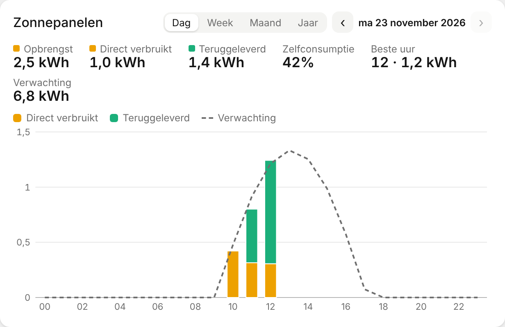 | 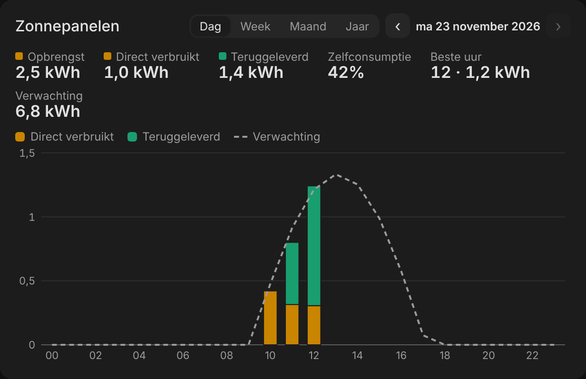 |

All options are optional:

```yaml
type: custom:energyplus-solar-card
title: Mijn titel                 # empty string hides the header
period: day                      # day | week | month | year (start view)
show_navigation: true            # period buttons and ‹ › in the card
energy_date_selection: false     # follow the date picker of the Energy dashboard
```

The forecast line is shown for the day and week views.

## Costs

`type: custom:energyplus-costs-card`

Electricity, gas and water costs and the feed-in compensation per hour, day or month, with the net total and the change versus the previous period.

| Light theme | Dark theme |
|---|---|
| 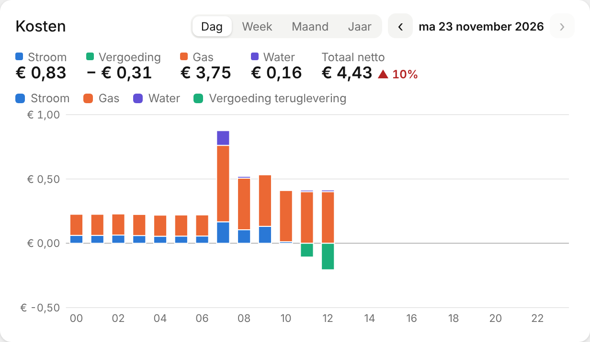 | 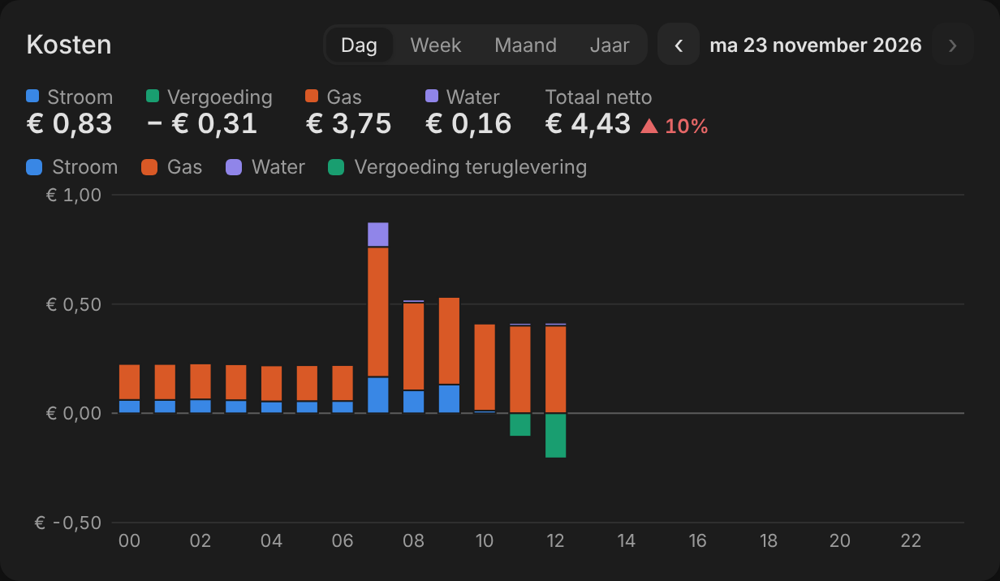 |

All options are optional:

```yaml
type: custom:energyplus-costs-card
title: Mijn titel                 # empty string hides the header
period: day                      # day | week | month | year (start view)
show_navigation: true            # period buttons and ‹ › in the card
energy_date_selection: false     # follow the date picker of the Energy dashboard
compare: true
```

Costs come from the cost statistics of the Energy dashboard, so set all-in prices there (including energy tax and VAT).

## Off-peak and peak

`type: custom:energyplus-tariff-card`

Import and return per meter register — tariff 1 = off-peak (*daltarief*), tariff 2 = peak (*piektarief*) — with net, price per kWh, cost and compensation, plus a chart over time.

| Light theme | Dark theme |
|---|---|
| 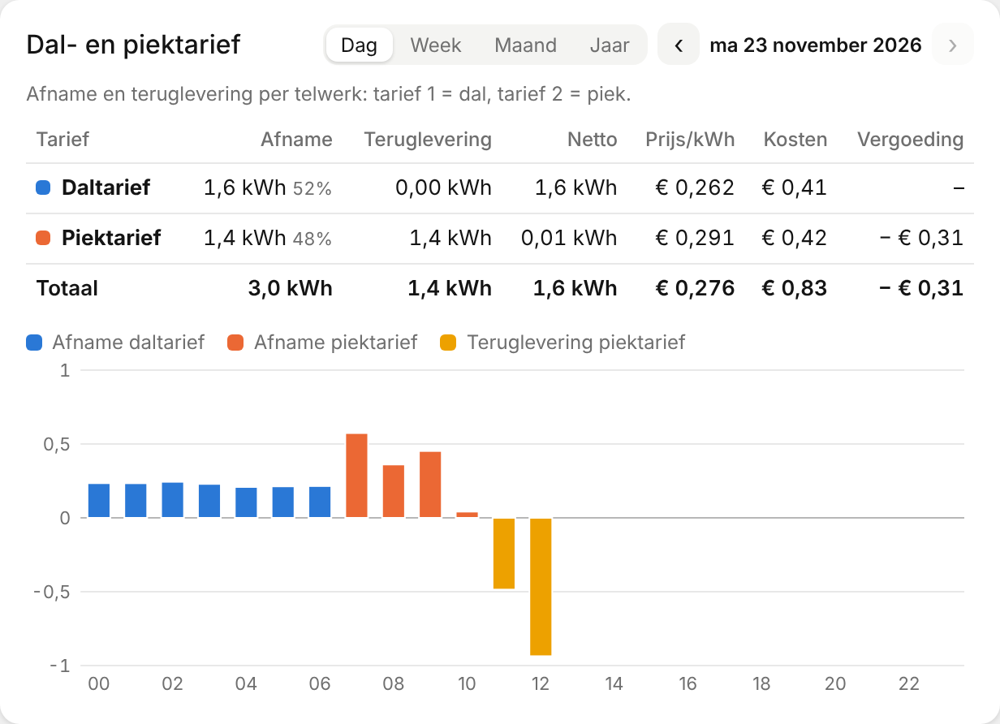 | 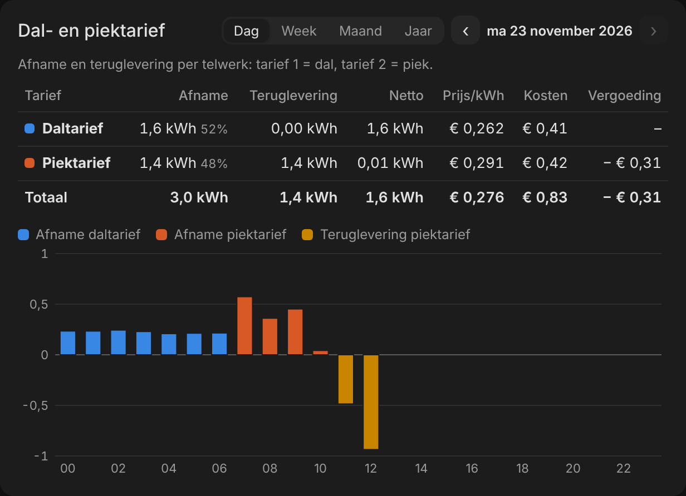 |

All options are optional:

```yaml
type: custom:energyplus-tariff-card
title: Mijn titel                 # empty string hides the header
period: day                      # day | week | month | year (start view)
show_navigation: true            # period buttons and ‹ › in the card
energy_date_selection: false     # follow the date picker of the Energy dashboard
```

Registers are recognised by name (*tarif 1*, *tariff 2*, *low*, *normal*, …); otherwise the first grid source is off-peak and the second is peak.

## Appliance cycles

`type: custom:energyplus-cycles-card`

Runs of your washing machine, dryer, dishwasher and oven, detected from hourly energy statistics: number of runs, runs per week, kWh and cost per run, share at the off-peak rate, usual start time and last run, plus a chart of start times with the off-peak hours marked. With a power sensor the card shows when an appliance is running now.

| Light theme | Dark theme |
|---|---|
| 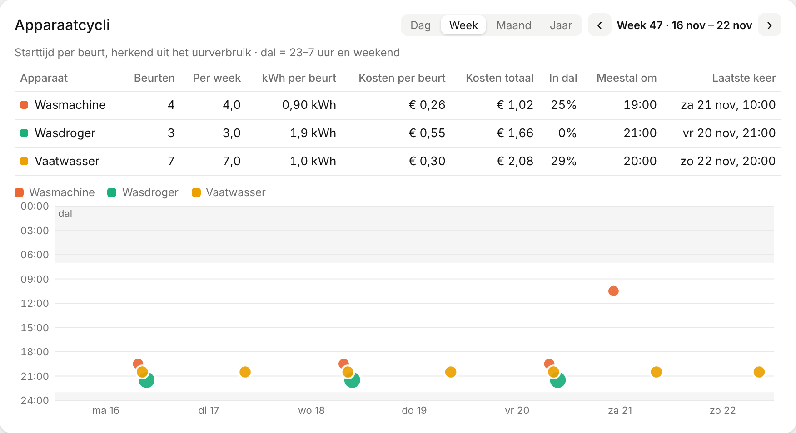 | 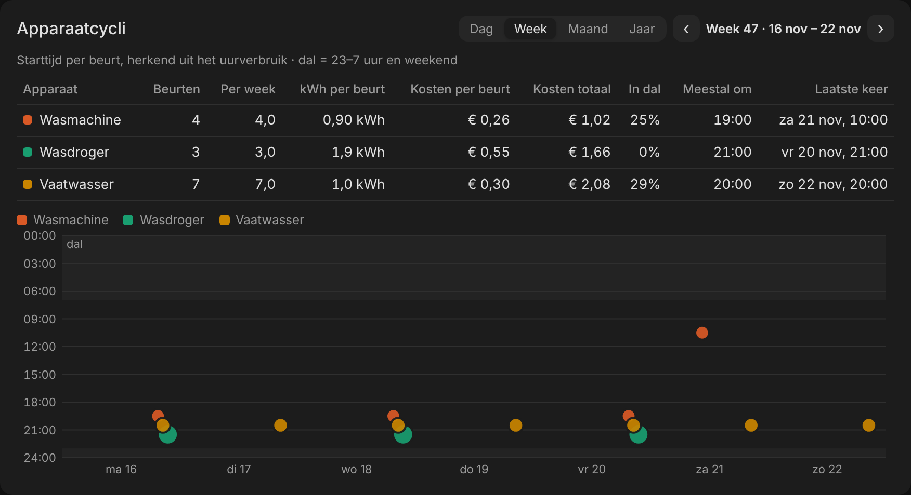 |

All options are optional:

```yaml
type: custom:energyplus-cycles-card
title: Mijn titel                 # empty string hides the header
period: week                     # day | week | month | year (start view)
show_navigation: true            # period buttons and ‹ › in the card
energy_date_selection: false     # follow the date picker of the Energy dashboard
devices:                         # optional: which Energy dashboard devices (energy statistic ids)
  - sensor.washer_energy
  - sensor.dishwasher_energy
```

Without `devices` the card picks devices whose name contains *was*, *droger*, *vaatwas*, *oven*, *magnetron*, *airfryer* (or *wash*, *dryer*, *dish*). A run is a sequence of hours above the device's standby level; one quiet hour inside a run is allowed. Because hourly statistics are used, two programmes right after each other can count as one run.

## Language and theme

The cards follow the language of your Home Assistant (Dutch or English) and its light
or dark theme.

## Privacy

The cards only read the Energy dashboard configuration, long-term statistics and entity
states through your own Home Assistant connection. They make no external requests and
change nothing in Home Assistant.

## License

MIT — see [LICENSE](LICENSE).
